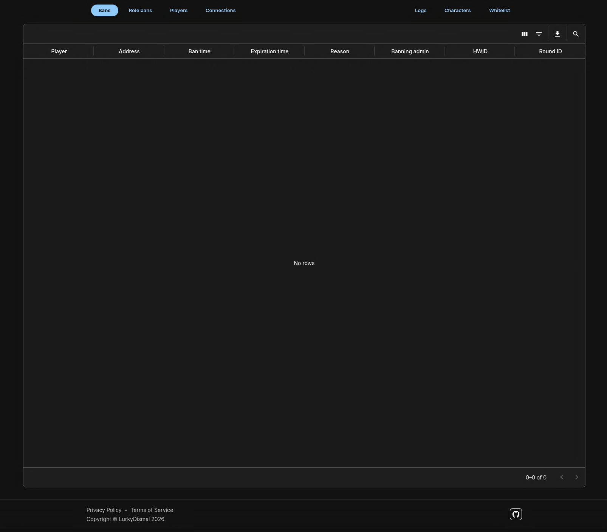
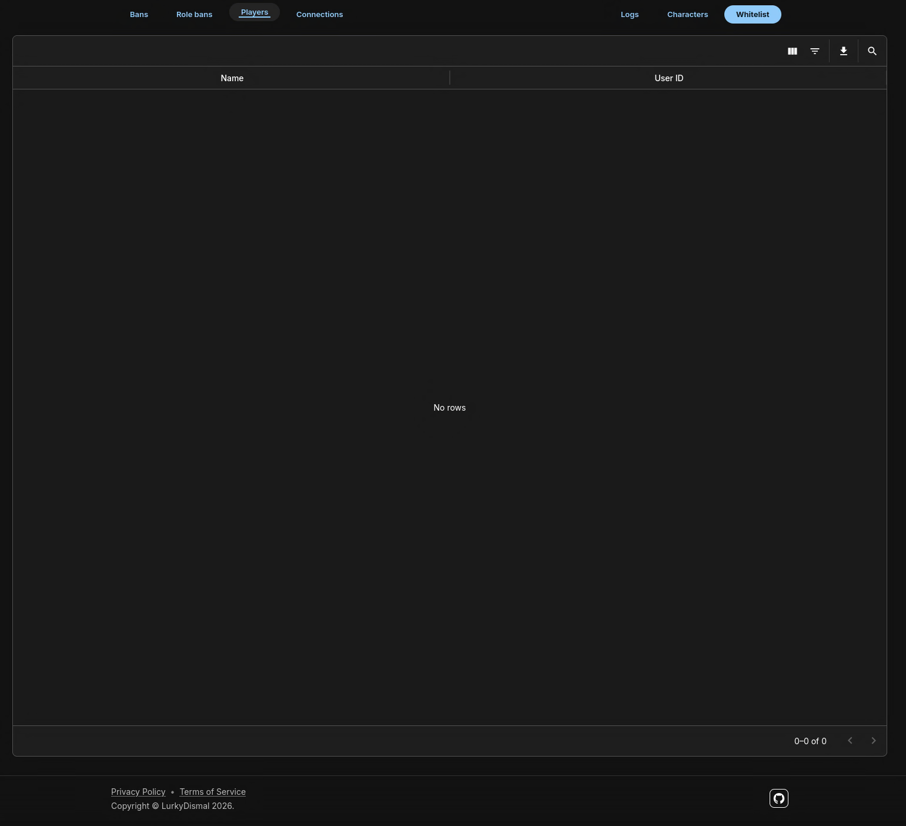
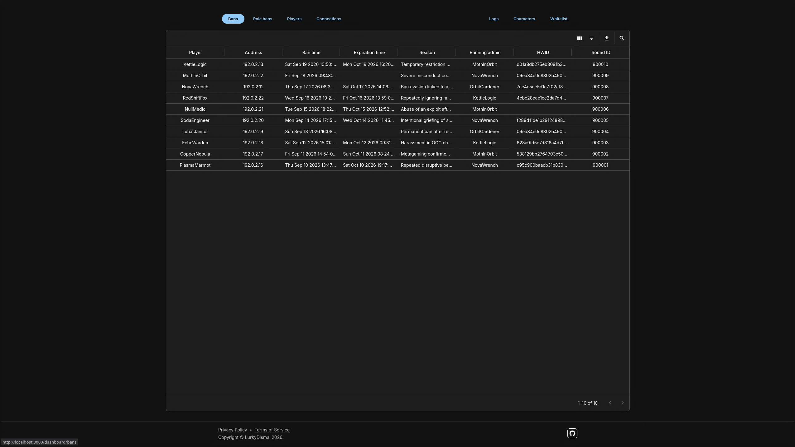
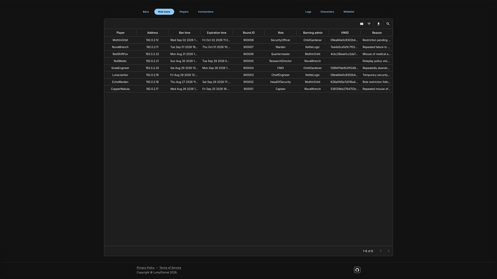
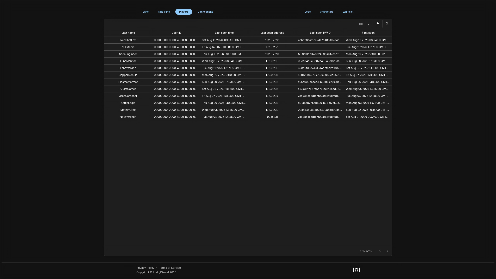
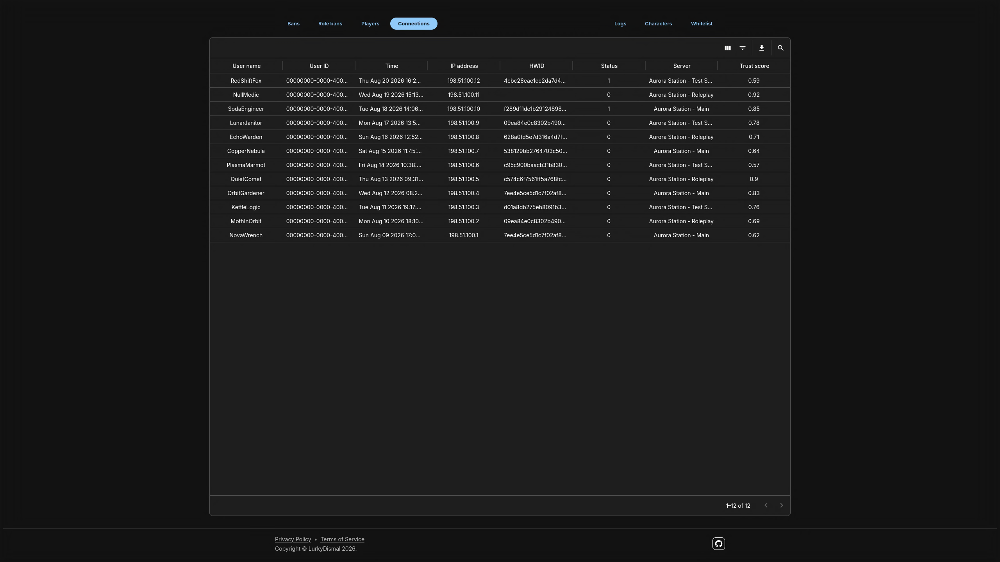
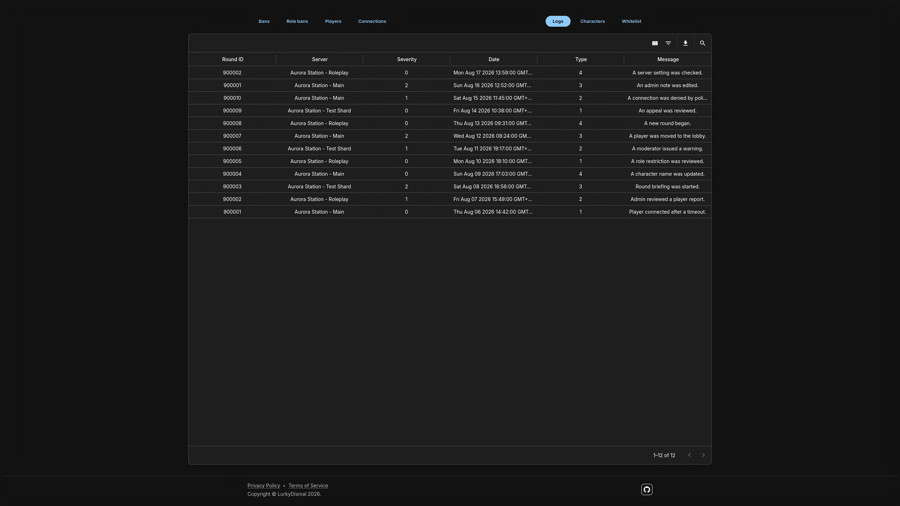
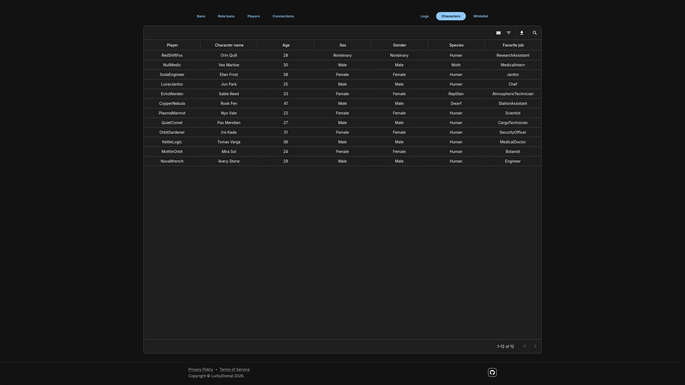
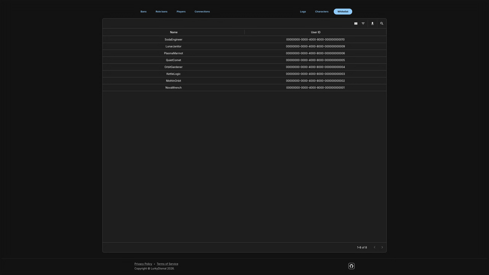

# Space Station 14 Server Administration Dashboard

> An in-progress web dashboard for browsing Space Station 14 server and player administration data.

## Table of Contents

- [General Information](#general-information)
- [Technologies Used](#technologies-used)
- [Features](#features)
- [Screenshots](#screenshots)
- [Setup](#setup)
- [Usage](#usage)
- [Project Status](#project-status)
- [Room for Improvement](#room-for-improvement)
- [Acknowledgements](#acknowledgements)
- [License](#license)

## General Information

This project provides a web interface for inspecting records stored in a PostgreSQL database used by a Space Station 14 server. It uses reusable, strongly typed data-grid components so that different pages can share common table behavior while defining their own columns and database queries.

The current dashboard includes views for:

- Player bans and role bans.
- Player records and connection history.
- Server logs.
- Character profiles.
- Whitelist entries.

The current implementation focuses on reading and exploring data; it does not provide complete create, update, and delete workflows. The database must contain a schema compatible with the definitions in `src/db/schema.ts` and the tables queried by the dashboard.

## Technologies Used

- Next.js 16
- React 19
- TypeScript 6
- Material UI 9 and MUI X Data Grid 9
- PostgreSQL
- Drizzle ORM and Drizzle Kit
- drizzle-zod and Zod
- React Hook Form
- Day.js
- pnpm
- Docker Compose and Caddy

## Features

- Dedicated views for bans, role bans, players, connections, logs, characters, and whitelist entries.
- Reusable, strongly typed MUI X Data Grid configured through per-page field definitions.
- Table quick search, sorting, filtering, and column visibility controls.
- CSV export and print-friendly table output.
- PostgreSQL queries and relational joins implemented with Drizzle ORM.
- Schema-derived TypeScript types and runtime validation for selected query results.
- Shared navigation, theming, autocomplete helpers, and snackbar notifications.

## Screenshots











## Setup

### Requirements

- Node.js compatible with the project's Next.js version.
- pnpm.
- PostgreSQL with a schema compatible with the application's Drizzle definitions.

Docker and Docker Compose are optional.

### Installation

1. Download or clone the repository and open its root directory.
2. Install dependencies:

    ```bash
    pnpm install
    ```

3. Create a local environment file:

    ```bash
    cp env.example .env
    ```

4. Edit `.env` to configure the PostgreSQL connection:

    ```dotenv
    POSTGRES_USER=postgres
    POSTGRES_PASSWORD=your_password
    POSTGRES_DB=appdb
    DB_HOST=localhost
    DB_PORT=5432
    ```

The application reads these five variables to connect to PostgreSQL. The database must already contain the tables and data the dashboard expects; the Compose configuration does not import or seed an existing Space Station 14 database automatically.

For local development, use a suitable development database. When connecting to a live server database, use a database account with only the privileges the dashboard needs. Do not run schema-changing commands against production without first reviewing their effects.

### Docker Compose

The Compose file defines application, PostgreSQL, and Caddy services, but the current configuration needs changes before it can be used as a complete deployment:

- Pass the database environment variables into the `app` service and set `DB_HOST=postgres` inside the container.
- Change the Caddy upstream in `conf/Caddyfile` from `localhost:3000` to `app:3000`, because Caddy runs in a separate container.
- Configure database schema initialization or connect PostgreSQL to a database that already has the required schema and data.

Review these settings before starting the stack. Do not expose an administration dashboard backed by sensitive server data publicly until authentication and authorization are in place.

## Usage

Start the development server:

```bash
pnpm dev
```

The application is available at `http://localhost:3000` by default.

Useful commands:

| Command         | Description                                                                                                                                            |
| --------------- | ------------------------------------------------------------------------------------------------------------------------------------------------------ |
| `pnpm dev`      | Start the development server with hot reload.                                                                                                          |
| `pnpm build`    | Build the production application.                                                                                                                      |
| `pnpm start`    | Start the production server after building.                                                                                                            |
| `pnpm generate` | Generate migrations from schema changes.                                                                                                               |
| `pnpm migrate`  | Apply pending Drizzle migrations.                                                                                                                      |
| `pnpm pull`     | Run Drizzle Kit schema introspection.                                                                                                                  |
| `pnpm push`     | Synchronize the Drizzle schema directly with the configured database. Review changes before using this against any database containing important data. |

The `justfile` also provides shortcuts for development, builds, database tasks, and Docker Compose operations.

The `lint` and `format` package scripts currently reference `fallow` and `oxfmt`, respectively; check that these tools are installed or update the scripts and dependencies before relying on those commands.

## Project Status

Project is: _in progress_. The current implementation focuses on read-only, database-backed administration views and reusable table components. It is not yet ready to expose to untrusted users.

## Room for Improvement

To do:

- Implement authentication and authorization before deployment.
- Add create, update, and delete workflows if editing records is required.
- Complete the Docker Compose configuration and document a reliable database setup process.
- Align linting and formatting scripts with the declared dependencies.
- Add deployment instructions.

## Acknowledgements

- [Space Station 14](https://spacestation14.io/) for the game and server context behind the dashboard.
- [Next.js](https://nextjs.org/) for the application framework.
- [Material UI](https://mui.com/) and [MUI X Data Grid](https://mui.com/x/react-data-grid/) for the interface and table components.
- [Drizzle ORM](https://orm.drizzle.team/) for PostgreSQL access and schema tooling.

## License

This project is open source and available under the [GNU Affero General Public License v3.0](LICENSE).
